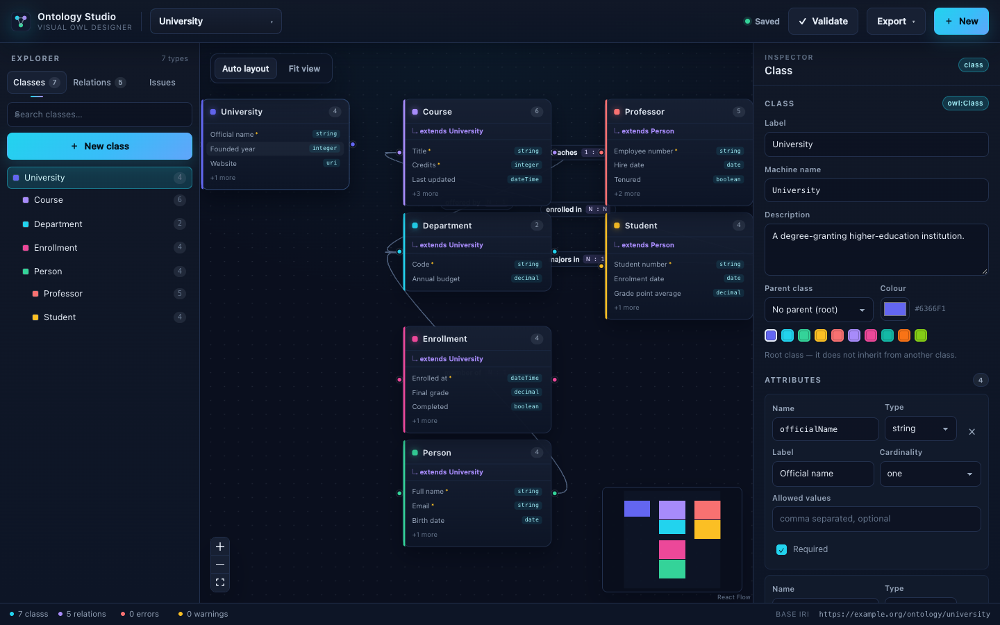
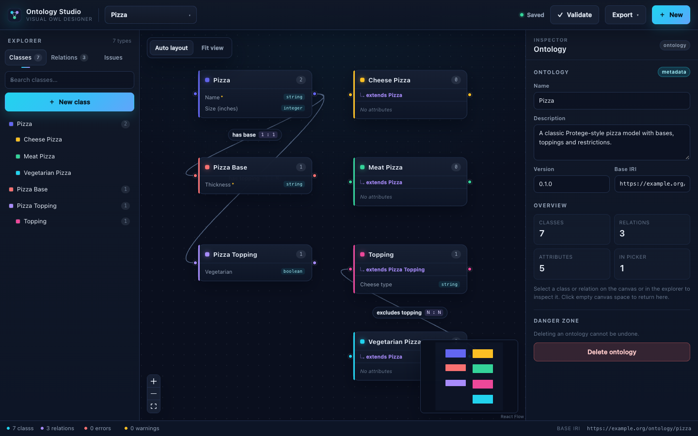
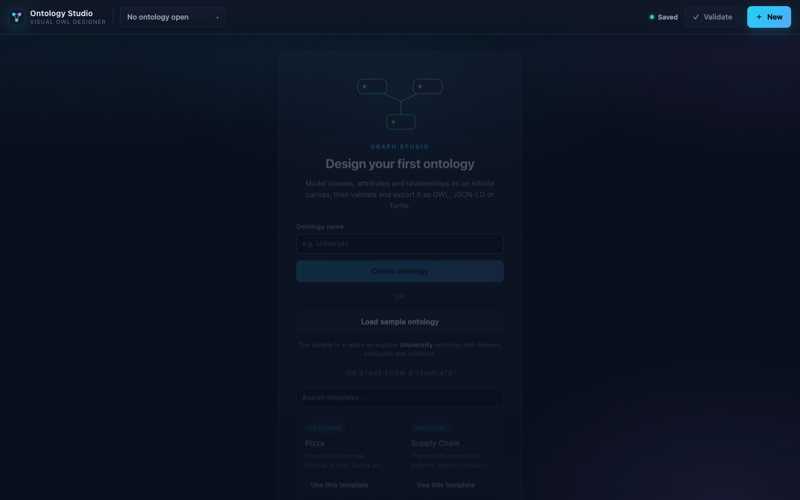
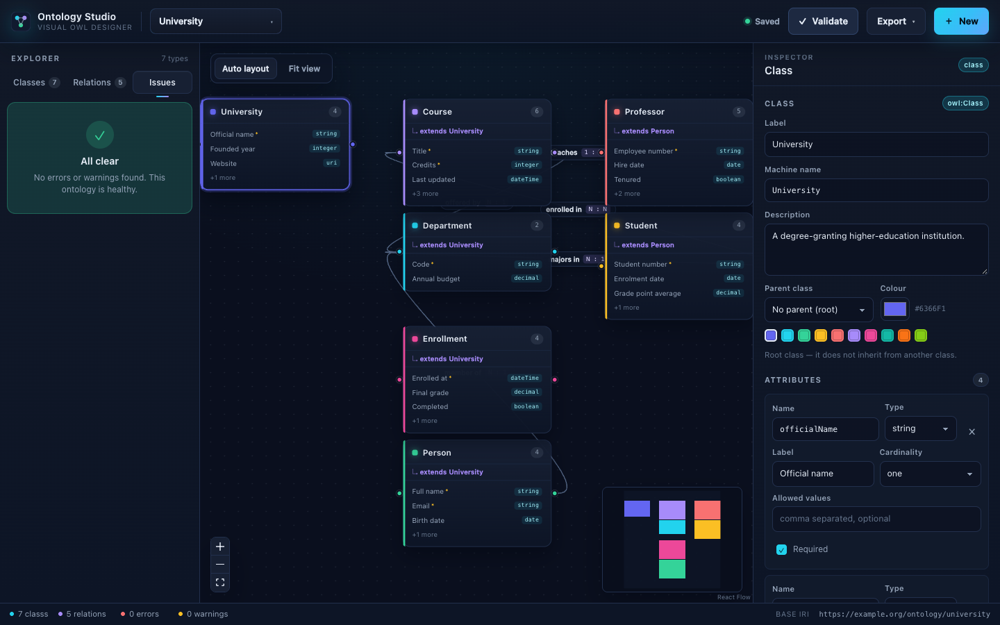
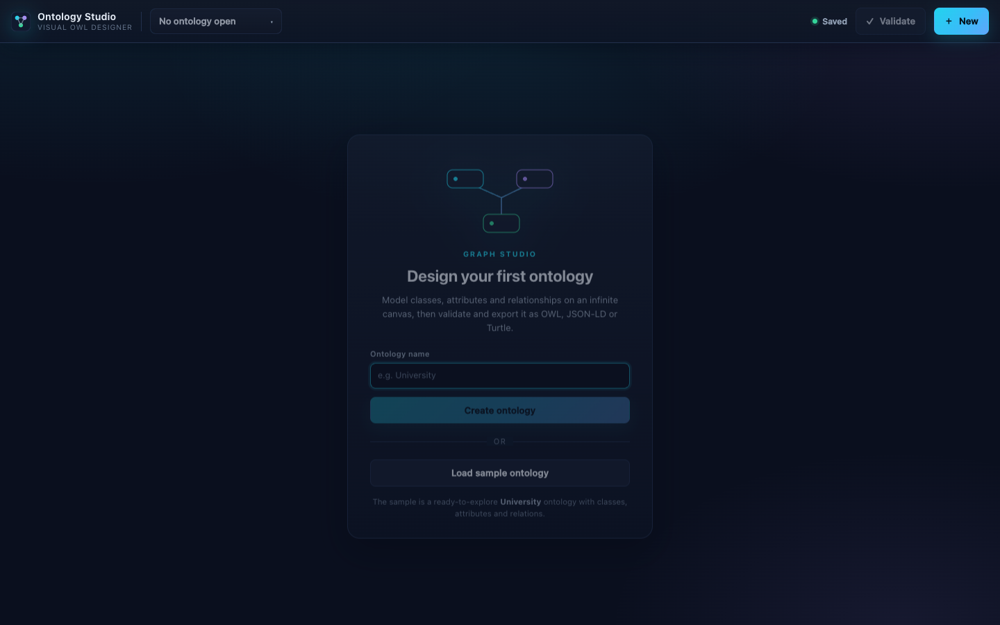

# Ontology Designer

Ontology Designer is a local, single-user studio for modelling an OWL-style ontology
visually. You define classes with single inheritance, typed attributes (datatype
properties) and directed relations (object properties) on an interactive graph, then
validate the model and export it as Turtle, JSON-LD or native JSON.

The project is a pnpm monorepo with a pure TypeScript domain core shared by a React 19
graph editor and a Fastify REST API. It is built test-first: Vitest unit and integration
tests for every package, plus a Playwright end-to-end suite that drives the real
application.

## Features

- **Visual class canvas.** Classes are nodes at persisted positions, relations are
  labelled edges. Pan, zoom, minimap, controls, fit-to-view and a deterministic
  automatic inheritance layout.
- **Class hierarchy sidebar.** Searchable class tree with single `subClassOf` parents;
  orphaned classes remain visible and repairable.
- **Property editing.** Inspector editing for class label, machine name, description,
  parent and colour; attributes with datatype, `required`, cardinality and enum values;
  relations with source, target, cardinality and label.
- **Autosave.** Debounced saves with a `Saved` / `Saving…` / `Unsaved changes` /
  `Save failed` indicator and manual retry. A transient failure never discards the
  in-memory document.
- **Validation.** Server-side validation returns a deterministic report of errors and
  warnings (17 issue codes covering naming, duplicates, inheritance and endpoint
  integrity). Issues are grouped in the sidebar and select the offending entity.
- **Ready-made templates.** Start from a real ontology instead of a blank canvas:
  pick from the **Pizza** (the classic Protégé tutorial model), **Supply chain**
  (batch/location/party traceability), **Education** or **Library** templates in the
  New-ontology dialog or the empty-state grid, then build on top and export.
- **Export and import.** The API produces Turtle (`.ttl`), JSON-LD (`.jsonld`) and native
  JSON (`.json`) downloads; native JSON documents can also be imported through the API
  without overwriting existing ontologies (a colliding import receives a fresh id and an
  `(imported)` name suffix).
- **Persistence.** On-disk and pluggable: a **JSON file store** (default, one document
  per ontology, atomic temp-file + rename) or an **embedded SQLite** backend
  (`ONTO_DB_TYPE=sqlite`, Node's built-in `node:sqlite`, ACID, indexed by last-updated).
  Ontologies survive page reloads and server restarts on either backend.
- **Sample ontology.** A ready-to-explore "University" model with a small inheritance
  tree, mixed datatypes and relations, guaranteed to validate with zero errors.

**Scope.** The studio is intentionally local and single-user: there is no
authentication, no collaborative editing and no graph database. The domain layer is
pure and deterministic so it can be tested and reused without the UI or the server.

## Screenshots

On the dark graph-studio theme: top bar, class sidebar, React Flow canvas,
inspector and status bar (layout per docs/UI-CONTRACT.md).











## Architecture at a glance

Three workspace packages, with a strict dependency rule: `@onto/core` is pure
TypeScript with no DOM, Node or framework dependencies; the apps depend on core, never
the other way round.

```
@onto/web (React 19 + React Flow + Zustand) ──┐
                                             ├──> @onto/core (pure domain)
@onto/server (Fastify + JSON file repo) ─────┘
```

- `@onto/core` owns the domain contract: factories, immutable mutations, queries and
  layout, validation, native JSON parsing/serialization, Turtle and JSON-LD export, the
  sample ontology and a catalogue of ready-made templates (Pizza, supply chain,
  education, library).
- `@onto/server` exposes the REST API, validates documents with core, and persists one
  JSON file per ontology through a repository interface (JSON-file adapter at runtime,
  in-memory adapter in tests).
- `@onto/web` is the studio: a typed API client, a Zustand vanilla store created by a
  factory, a pure graph mapping, and React components driven by `data-testid` seams.

Full component, domain-model and sequence diagrams are in
[docs/ARCHITECTURE.md](docs/ARCHITECTURE.md).

## Quick start

Prerequisites: Node.js 22 or newer and pnpm 9 (the repository pins
`packageManager: pnpm@9.1.0`).

```bash
pnpm install
pnpm dev
```

`pnpm dev` starts both applications together:

- Web studio: <http://127.0.0.1:5173>
- API: <http://127.0.0.1:5174> (health check at <http://127.0.0.1:5174/api/health>)

The web dev server proxies `/api` to the API, so the browser sees a single origin.
Create your first ontology from the empty-state card, or choose "Load sample ontology"
to explore the University model.

To run only one side: `pnpm dev:api` or `pnpm dev:web`.

For a production-style run, build everything and let the API serve the built web app:

```bash
pnpm build
ONTO_WEB_DIST=apps/web/dist pnpm start
```

## Scripts

| Command | Description |
| --- | --- |
| `pnpm dev` | Run the API and web dev servers together (`concurrently`). |
| `pnpm dev:api` | Run only `@onto/server` with `tsx watch` on port 5174. |
| `pnpm dev:web` | Run only `@onto/web` with Vite on port 5173. |
| `pnpm build` | Build all packages recursively (`pnpm -r build`). |
| `pnpm start` | Start the built API server (set `ONTO_WEB_DIST` to serve the SPA). |
| `pnpm test` | Run every package's Vitest suite (`pnpm -r test`). |
| `pnpm test:watch` | Run package test suites in watch mode in parallel. |
| `pnpm typecheck` | Type-check every package (`tsc --noEmit`). |
| `pnpm e2e` | Run the Playwright end-to-end suite against the real app. |
| `pnpm e2e:install` | Install the Chromium browser used by Playwright. |
| `pnpm check` | `typecheck` followed by `test` — the standard pre-handoff gate. |

Package-level equivalents work too, for example `pnpm --filter @onto/core test`.

## Repository layout

```
ontology-designer/
├── apps/
│   ├── server/            @onto/server — Fastify REST API and persistence
│   │   ├── src/           app.ts (buildApp), repository.ts and its adapters,
│   │   │                  server entrypoint
│   │   └── test/          Vitest integration tests using app.inject
│   └── web/               @onto/web — React studio
│       ├── src/           api/client.ts, state/, graph/toFlow.ts, components/
│       └── test/          Vitest + Testing Library tests
├── packages/
│   └── ontology-core/     @onto/core — pure domain model
│       ├── src/           types, naming, model, validation, serialization,
│       │                  exporters and sample ontology
│       └── test/          Vitest unit tests
├── e2e/                   Playwright scenarios (designer.spec.ts, visual.spec.ts)
├── docs/
│   ├── DOMAIN-CONTRACT.md authoritative domain behaviour
│   ├── API-CONTRACT.md    authoritative HTTP API behaviour
│   ├── UI-CONTRACT.md     authoritative UI layout, flows and test ids
│   ├── ARCHITECTURE.md    diagrams and package responsibilities
│   ├── DEVELOPMENT.md     development, testing and troubleshooting guide
│   ├── GLOSSARY.md        project vocabulary
│   └── adr/               architecture decision records
├── playwright.config.ts   E2E configuration (Chromium, 5173 + 5174)
├── pnpm-workspace.yaml    workspace globs: packages/* and apps/*
├── tsconfig.base.json     shared strict TypeScript settings
└── package.json           root scripts and dev tooling
```

Contract-defined seams: `apps/web/src/api/client.ts` (`OntologyApi`,
`createOntologyApi`), `apps/web/src/state/store.ts` (`createOntologyStore`),
`apps/web/src/graph/toFlow.ts` (pure graph mapping), the server's exported
`buildApp({ repository })` in `apps/server/src/app.ts`, and the repository interface
with its in-memory and JSON-file adapters in `apps/server/src/repository.ts`.

## Testing strategy

Development follows test-driven development in small vertical slices: write one failing
test, make it pass with the minimum implementation, refactor, then take the next slice
through the same seams. No layer is "done" until its seam has a test.

| Layer | Tool | Location | Seam |
| --- | --- | --- | --- |
| Domain unit | Vitest (node) | `packages/ontology-core/test` | Pure functions imported directly; injected ids/timestamps and deterministic export. |
| API integration | Vitest (node) | `apps/server/test` | `buildApp({ repository })` with an in-memory repository and `app.inject`; no listening port. |
| Store and components | Vitest + Testing Library (jsdom) | `apps/web/test` | `createOntologyStore(fakeApi)`, pure `toFlow` mapping, `data-testid` queries; network mocked. |
| End-to-end | Playwright (Chromium) | `e2e/` | Real web app and real API, driven through the contract test ids. |

`pnpm e2e` boots both servers automatically (reusing already-running dev servers
outside CI) against a throwaway `.e2e-data` directory.

## Documentation

- [docs/ARCHITECTURE.md](docs/ARCHITECTURE.md) — component, domain and sequence
  diagrams; package responsibilities; dependency rule.
- [docs/DEVELOPMENT.md](docs/DEVELOPMENT.md) — setup, run and test commands, the
  TDD-first workflow, test seam map, environment variables and troubleshooting.
- [docs/GLOSSARY.md](docs/GLOSSARY.md) — ontology, class, property, IRI, validation,
  seam, tracer bullet and other project terms.
- [docs/DOMAIN-CONTRACT.md](docs/DOMAIN-CONTRACT.md) — authoritative domain behaviour
  and the frozen `@onto/core` types.
- [docs/API-CONTRACT.md](docs/API-CONTRACT.md) — endpoints, error shape, environment
  variables and persistence layout.
- [docs/UI-CONTRACT.md](docs/UI-CONTRACT.md) — layout, interaction flows, component
  seams and required `data-testid` attributes.
- [docs/adr/](docs/adr/) — architecture decision records:
  [0001 monorepo](docs/adr/0001-pnpm-monorepo-with-shared-core.md),
  [0002 pure immutable core](docs/adr/0002-pure-immutable-domain-core.md),
  [0003 contract-first seams](docs/adr/0003-contract-first-package-seams.md),
  [0004 React Flow and Zustand](docs/adr/0004-react-flow-canvas-and-zustand-store.md),
  [0005 Fastify and JSON files](docs/adr/0005-fastify-rest-and-json-file-repository.md),
  [0006 TDD vertical slices](docs/adr/0006-tdd-vertical-slices.md).

## Project status

The contracts, workspace scaffolding, strict TypeScript configuration and frozen domain
types are complete. `@onto/core` and `@onto/server` are implemented and covered by passing
Vitest suites; the `@onto/web` store, components and tests are in their final pass, and the
Playwright E2E specs are written against the contract test ids. Where a document describes
a module that is not yet complete, treat the intended architecture fixed by the contracts
as the target.
