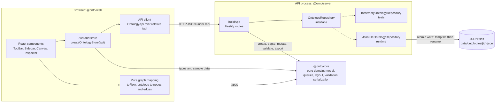
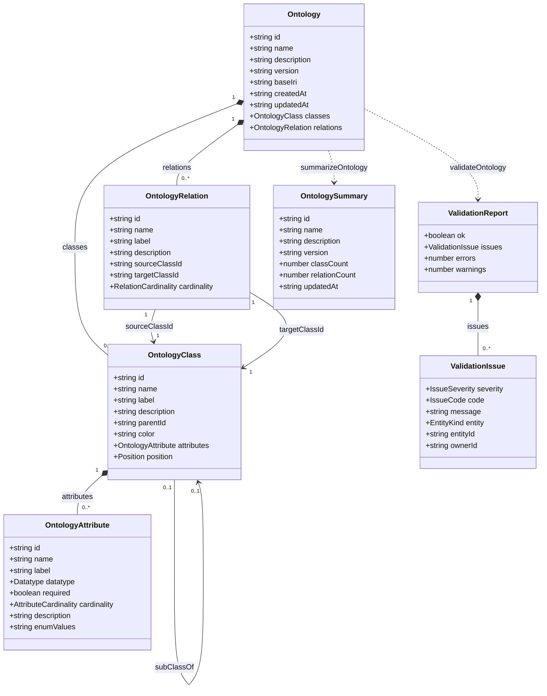
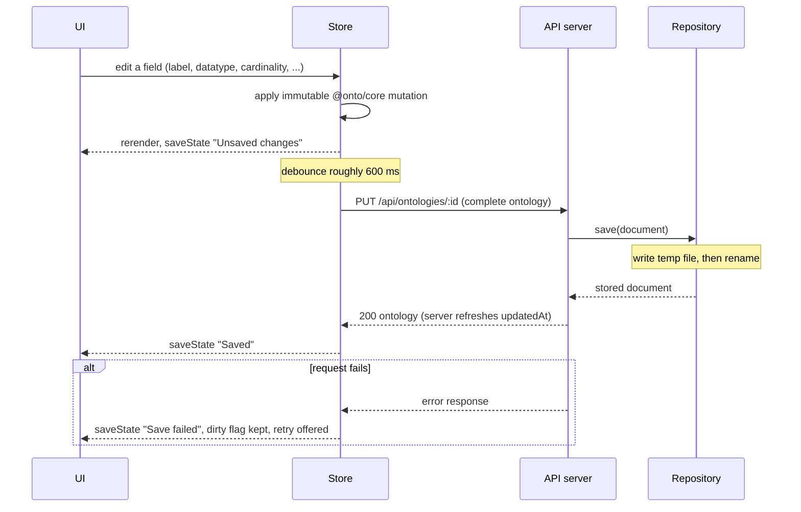
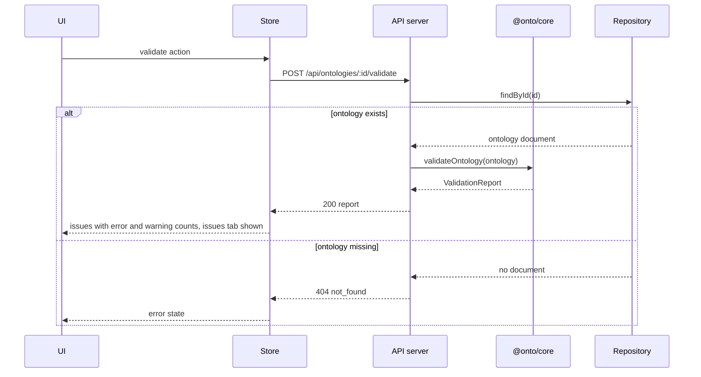
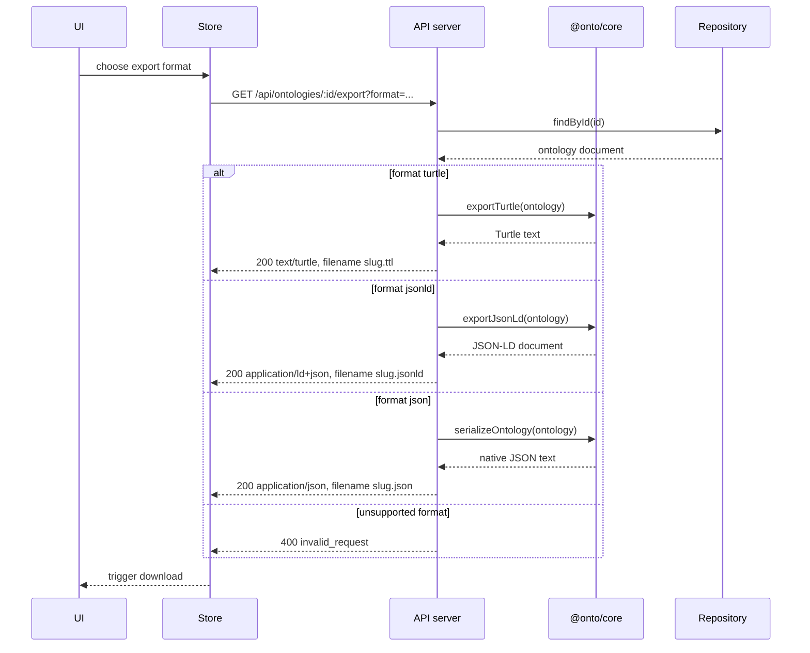
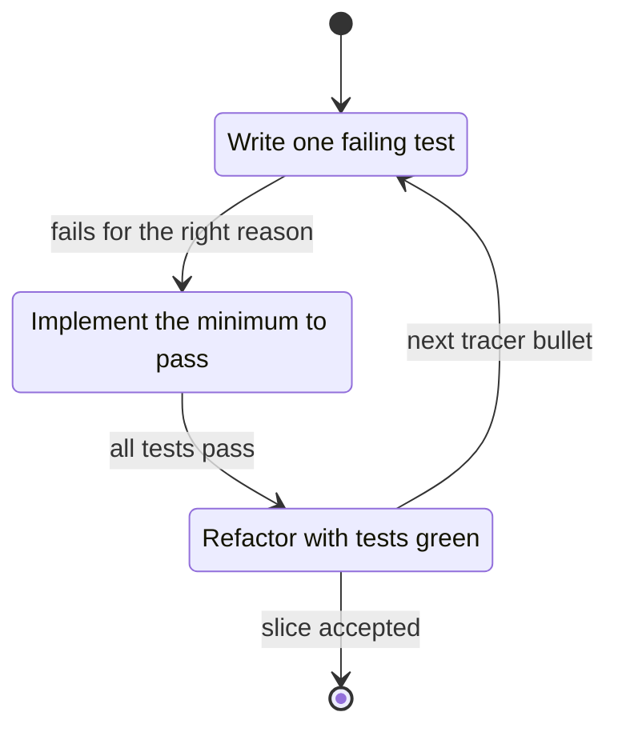

# Architecture

Ontology Designer is a pnpm monorepo with three workspace packages and one shared
dependency rule: `@onto/core` is a pure TypeScript domain library, and both applications
depend on it. The core knows nothing about the browser, the server, HTTP or files.

This document describes the architecture fixed by the
[domain contract](DOMAIN-CONTRACT.md), [API contract](API-CONTRACT.md) and
[UI contract](UI-CONTRACT.md). The core library and the API are implemented and tested;
the last web UI components and their tests are still landing, so where a module is not
yet complete, treat the contract as the source of truth.

## Dependency rule

| Package | Layer | May depend on | Must not depend on |
| --- | --- | --- | --- |
| `@onto/core` | Pure domain | Nothing (only injected ids and timestamps) | DOM, Node APIs, Fastify, React, Zustand, `@onto/*` |
| `@onto/server` | API and persistence | `@onto/core`, Fastify, Node | `@onto/web` |
| `@onto/web` | Presentation | `@onto/core`, React, React Flow, Zustand | `@onto/server` |

The applications talk to each other only through the HTTP contract, never by importing
each other's code. The core is the only package that both sides share, and it is pure:
every mutation returns a new value, and the only non-deterministic inputs — ids and
timestamps — are injectable or tolerated by tests.

## 1. System context and components

The browser studio talks JSON over HTTP to the Fastify API. The API persists each
ontology as a JSON file through a repository interface. Both applications import the
shared domain core for the behaviour they must agree on.

- In development the web dev server proxies `/api` to `127.0.0.1:5174`, so the browser
  uses one origin. In production the API can serve the built web app from
  `ONTO_WEB_DIST` with an SPA fallback, which removes the cross-origin hop entirely.
- The API owns persistence. The web app never writes files and never assumes where data
  lives; it only sends complete ontology documents through the REST contract.
- The repository is a seam as well as an abstraction: tests build the API with an
  in-memory adapter, while `server.ts` wires the JSON-file adapter rooted at
  `ONTO_DATA_DIR`.
- `@onto/core` appears on both sides because the contracts require both to agree on
  documents. The browser uses core types and helpers; the API uses core factories,
  parsing, validation and export; no behaviour is duplicated.

## 2. Domain model

One `Ontology` aggregate owns a list of classes and a list of relations. Classes own
attributes and may point at a single parent class. Validation is a pure projection that
returns a report; the list projection used by the ontology picker is another.

- The frozen TypeScript interfaces live in `packages/ontology-core/src/types.ts`; the
  diagram above is a summary, not a second source of truth.
- Referential integrity is deliberately not a load-time requirement: a document may
  reference a missing parent or endpoint and still parse, so users can repair it. Such
  documents produce `unknown-parent`, `unknown-relation-source` or
  `unknown-relation-target` validation errors instead.
- `OntologySummary` is a read projection for the picker; it is never persisted.
- Ids are stable local UUIDs and are never shown to end users; labels and machine names
  are the user-facing identity. IRIs are minted from the current base IRI and the entity's
  machine name at export time — `:<Class>`, `:<attributeName>` and `:<relationName>` in
  Turtle, and `baseIri#name` in JSON-LD — so changing the base IRI does not rewrite stored
  ids.
- A new ontology's default base IRI is `https://example.org/ontology/<slug(name)>`. The
  slug falls back to `ontology` when the name contains no ASCII letters or digits, so a
  non-ASCII name still produces a valid absolute base IRI.

## 3. Runtime sequences

### Autosave

Inspector edits are applied to the in-memory document immediately, then persisted after
a short debounce. The save indicator reports the result of the most recent attempt, and
a failed attempt keeps the document dirty so it can be retried.

The store never discards the current document on a transient failure. It keeps the
dirty flag and exposes a manual save, so a network hiccup cannot lose work.

### Validation

Validation is requested explicitly from the top bar. Running it on the server keeps one
validator authoritative and lets the UI show the exact persisted document's issues.

Issue ordering is deterministic: ontology-level issues first, then classes in document
order (the class issue followed by its attribute issues), then relations in document
order. The sidebar renders issues in exactly that order, so an issue's index is a stable
test id and a stable selection target.

### Export

Exports are produced by the server from the stored document, so a downloaded file always
matches what the API holds.

The export endpoint defines three formats: `turtle`, `jsonld` and `json`. The `json`
format returns exactly `serializeOntology(ontology)` — the canonical, round-trippable
native document — as an `application/json` attachment with a `<slug>.json` filename, so a
downloaded file can be imported again without loss. Any other format is a
`400 invalid_request`. See [DEVELOPMENT.md](DEVELOPMENT.md) for the contract-first
workflow.

## 4. The TDD loop used to build it

The project was built in small red-green-refactor cycles, one vertical slice at a time.
Each cycle starts with a failing test at a chosen seam, then the minimum implementation,
then a deliberate cleanup while the suite stays green.

- A slice is done only when it has tests at every seam it touches: core unit test, API
  integration test, store or component test, and — for user-visible behaviour — a
  Playwright scenario.
- Tests target the published seams (pure functions, `buildApp` with an injected
  repository, the store factory with a fake API, `data-testid` attributes), so
  implementation details can change during refactoring without rewriting tests.
- The detailed workflow, test seam map and a worked tracer-bullet example are in
  [DEVELOPMENT.md](DEVELOPMENT.md).

## State and error handling

- The web app has one store per mounted application. State: ontology summaries, the
  open ontology, the current selection, the latest validation report, the sidebar tab,
  the save state, any error and the boot flag.
- Every API failure is normalised by the API client into a typed `ApiError` carrying the
  HTTP status, the error code and the message, so the store can decide between a
  recoverable save failure, a not-found reload and a fatal boot failure.
- The API returns a single error envelope for non-2xx responses:
  `{ "error": { "code", "message", "details"? } }`.
- Persistence writes are atomic per document (temp file then rename), so a crash cannot
  leave a half-written ontology behind.

## Related documents

- [DOMAIN-CONTRACT.md](DOMAIN-CONTRACT.md) — authoritative core behaviour.
- [API-CONTRACT.md](API-CONTRACT.md) — routes, errors, environment and data directory.
- [UI-CONTRACT.md](UI-CONTRACT.md) — layout, flows and component test seams.
- [GLOSSARY.md](GLOSSARY.md) — vocabulary used above.
- [DEVELOPMENT.md](DEVELOPMENT.md) — how to run, test and extend the project.
- [ADRs](adr/0001-pnpm-monorepo-with-shared-core.md) — why these boundaries exist.
